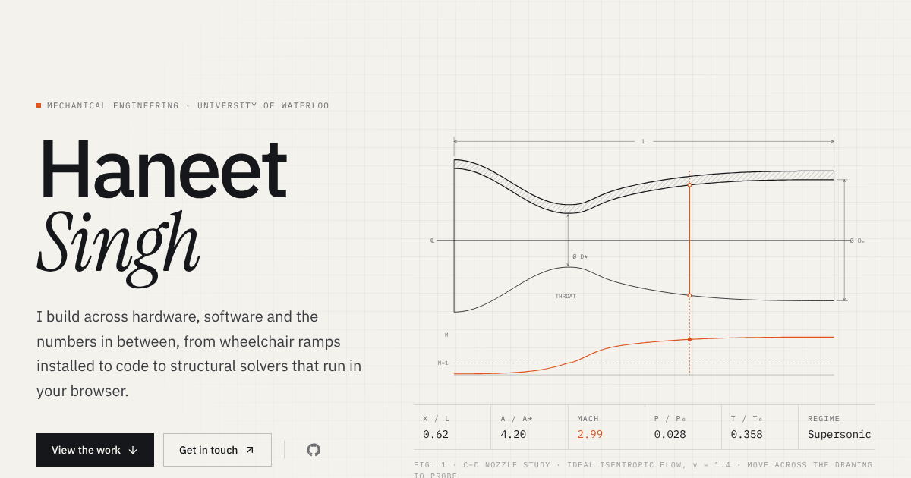

# haneet10.github.io

The personal portfolio of **Haneet Singh**, Mechanical Engineering (Co-op) at the University of Waterloo.

**Live site:** https://haneet10.github.io



## What's on it

- **Cover**: an interactive half-section of a rocket nozzle. Move across it and it computes the local Mach number, pressure and temperature for ideal isentropic flow, live.
- **Key results**: four headline numbers under the cover, each linking to the work behind it.
- **Work**: five projects. Each page reads like a drawing sheet: *Brief* (the problem), *Process* (how it was built, step by step), *Failure mode* (what went wrong and the fix), *Outcome*, and *Rev. B* (what the next version changes), then a spec sheet, photos and a *For engineers* section. Two pages have working calculators (ramp slope, loan amortization).
- **Reports and downloads**: every project has a full report page plus a PDF of its printed sheets (`public/reports/<slug>.pdf`), and the whole printable portfolio downloads from the header, the cover and the contact section (`public/reports/Haneet-Singh-Engineering-Portfolio.pdf`). The web edition leaves out the phone number and the résumé page.
- **Experience, Skills, Education, Contact**. Skills link to the projects that use them instead of showing made-up percentage bars.
- **Navigation**: press ⌘K / Ctrl+K (or the *Jump to* button) to jump to any section, project or link. Wide screens also get a sheet index on the right edge, and project pages have an "On this sheet" contents list.

The design idea is *the drawing set*: paper, ink, hairlines, numbered sheets and one signal-orange accent, in light and dark themes.

## Editing content

Everything you'd want to change is in `src/content/`:

| File | What it holds |
|---|---|
| `profile.ts` | Name, email, links, nav, key results |
| `projects.ts` | Every project, with `skills`, `purpose`, `approach`, `challenge`, `result`, `next` and `outcomes`. Add one by appending an object |
| `resume.ts` | Experience (Waterloo Rocketry work goes here as it happens), skills, education |

**Adding a project with photos**

1. Put the photos in any folder (HEIC should be converted to JPG first).
2. Add an entry per photo to `scripts/image-manifest.mjs`.
3. Run `npm run images -- <that-folder>`. It writes resized WebP files to `public/images/` and strips all metadata, including GPS location.
4. Add the project to `src/content/projects.ts`, referencing images as `"folder/name"`.

**Updating the PDFs.** The printable portfolio is built from its own source (kept in the project files under `portfolio-print/`). Render the web edition, then split it: ramps = pages 4–5, joystick 6–7, rover 8–9, walkie-talkie 10, finance 11.

## Running locally

```bash
npm install
npm run dev        # http://localhost:3000
npm run build      # static site in out/
```

Pushing to `main` builds and deploys to GitHub Pages automatically (`.github/workflows/deploy.yml`).

## For engineers

- Next.js 16 (App Router, static export), React 19, TypeScript, Tailwind CSS 4, Motion, Lenis, Lucide.
- Fully static: no server, no client-side data fetching. Every project page is pre-rendered at build time.
- Self-hosted IBM Plex Sans / Plex Mono / Instrument Serif via Fontsource, so there are no third-party font requests.
- Responsive images: each photo ships at 640 / 1280 / 1920 px WebP with `srcset`; intrinsic sizes come from `src/content/images.generated.json` so layout never shifts.
- Accessibility: skip link, landmarks, visible focus rings, keyboard-driven lightbox, `prefers-reduced-motion` respected throughout, theme set before first paint.
- SEO: per-page metadata, Open Graph image, JSON-LD `Person`, sitemap and robots.

The nozzle figure solves the area–Mach relation `A/A* = (1/M)·[(2/(γ+1))(1 + (γ−1)/2·M²)]^((γ+1)/(2(γ−1)))` by bisection on the subsonic branch upstream of the throat and the supersonic branch downstream, with γ = 1.4.
